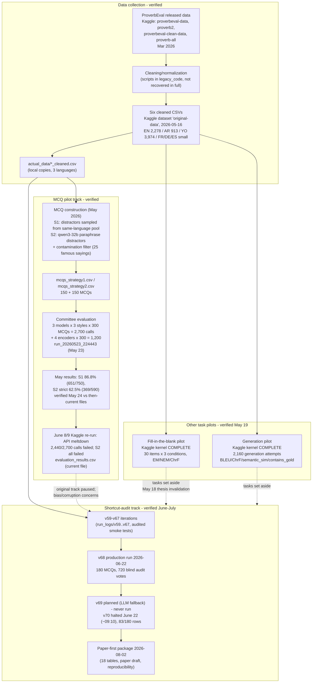

# Dataset Lineage — How Records Flowed Through ProverbGap

**Rule:** every arrow below is labeled with its evidence status. `verified` = artifacts and/or logs exist and were inspected on 2026-10-26. `planned` = documented intention only. Paths point into the source repository `saaga23/proverb_mcq` unless marked "Kaggle".

---

## 1. Historical workflow (what actually happened)

Solid arrows = verified flow. Dotted arrows = documented transitions (decision, not data flow).

---

## 2. Stage-by-stage detail

### Stage 1 — Source collection → cleaned records (`verified`)
- Input: published ProverbEval datasets scraped/duplicated into Kaggle datasets `proverbeval-data`, `proverb2`, `proverbeval-clean-data`, `proverb-all` (March 2026), then consolidated.
- Output: six cleaned CSVs uploaded as Kaggle dataset `abrahamsunday123/original-data` (2026-05-16) and mirrored locally in `actual_data/`.
- **Unit:** one proverb record (text + translation + cultural meaning).
- Transform code: cleaning scripts were part of the legacy pipeline; full cleaning code was **not recovered** (legacy_code contains pipeline code; cleaning provenance for each language is documented only narratively). Confidence: schema **Verified**; row counts **Verified**; cleaning logic **Inferred/partially unknown**.

### Stage 2 — Cleaned record → MCQ item (`verified` for the May pilot; `verified` for v68 with different code)
- May pipeline (S1/S2): documented in `ProverbGap_Paper_Draft.md` §4 and verified by the May 24 cross-verification report; input `mcqs_strategy1/2.csv`; outputs 300 MCQs.
- v68 pipeline: `src/generation/openrouter_pilot_distractor_generation_test_nano_opus.py` (code **verified present**); input = curated 15-proverb subset; output `pilot1_test_generated_mcqs.csv` (180 MCQs). Filter model caches (NLI cross-encoder, MiniLM paraphrase model) exist under `model_cache/` — consistent with the semantic filters.
- **Unit change:** proverb record (1) → MCQ (up to 2 in May: S1+S2; 1 in v68 per variant×generator cell).

### Stage 3 — MCQ → model responses (`verified`, but two different regimes)
- May: `evaluation_results.csv` — 3 committee models × 3 styles × 300 MCQs (2,700 rows, June re-run variant) + `encoder_results.csv` (1,200 rows).
- v68: `pilot1_test_raw_outputs.csv` (903 calls) and per-auditor `vote_/hit_` columns in `pilot1_test_audit_results.csv` (4 auditors × 180 = 720 votes).
- **Unit:** one model response to one item under one condition.

### Stage 4 — Responses → metrics (`verified` for v68; `verified-at-the-time` for May)
- May: strategy accuracy = mean(`hit`) per strategy over non-error rows; S1 651/750 = 86.8%; S2 strict 369/590 = 62.5%; McNemar χ²=131.3, p<0.001. **Primary artifacts subsequently overwritten** — these figures now rest on the May 24 verification reports (evidence level 5/6), not on surviving raw data.
- v68: consensus accuracy 102/180 = 56.7%; perfect consensus 75/180; HCW 50/180 (recomputed directly from `pilot1_test_audit_results.csv` on 2026-10-26 — **independently reproduced**).
- v68 analysis layer: `kaggle/run_logs/v68/table_*.csv` (18 tables) and `paper/tables/` mirrors.

### Stage 5 — Other formats (FiB, Generation) (`verified` as small pilots; `planned` at scale)
- FiB: proverb → cloze (`displayed_proverb` masks `gold_word`) → 3 conditions (gold word / paraphrase / sham proverb) → EM/NEM/ChrF per condition. 30-item pilot on Kaggle (COMPLETE). **No scale-up artifact found.**
- Generation: proverb + gold explanation → model explanation → BLEU/ChrF/semantic similarity + `contains_gold` copying detector. 2,160 attempts on Kaggle (COMPLETE). No aggregated analysis table found.
- Both were **set aside after the May 18 thesis invalidation**; they are the natural Phase 2 formats for the cultural-reasoning question.

### Stage 6 — Human validation (`planned` end-to-end)
- Sampling done: 60-item stratified sample + 30-item v68 sample (**verified**, both unfilled).
- Tooling done: `annotation_app/` (Next.js + Supabase, Playwright-tested, Vercel-deployed) (**verified built**).
- Annotation execution: **never performed** — no filled annotation records anywhere in the repo; Supabase backend state unexamined (needs owner access).

---

## 3. Units of observation (do not mix)

| Unit | Count (verified) | File |
|---|---|---|
| Proverb record | 2,278 / 913 / 3,974 (EN/AR/YO) | `actual_data/*_cleaned.csv` |
| Generated MCQ (May) | 150 S1 + 150 S2 | `mcqs_strategy*.csv` |
| Generated MCQ (v68) | 180 | `pilot1_test_generated_mcqs.csv` |
| Model response (May) | 2,700 rows (260 valid) | `evaluation_results.csv` |
| Audit vote (v68) | 720 (4 × 180) | per-auditor columns |
| Committee verdict (v68) | 180 | `pilot1_test_audit_results.csv` rows |
| FiB pilot result | 30 items × 3 conditions | `nb_pilot_30_results.csv` |
| Generation attempt | 2,160 | `pilot_results.csv` |

## 4. Planned (not run) extensions
- Scale-ups: N=700 MCQ (May plan), N=15 (v70 plan) — both blocked by budget.
- LLM-fallback ablation (v69 design documented in `v68_detailed_analysis_report.md` §7.2).
- FiB/Generation at scale; embedding-based distractor diversity; 100-item human audit.
